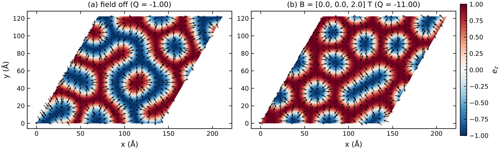
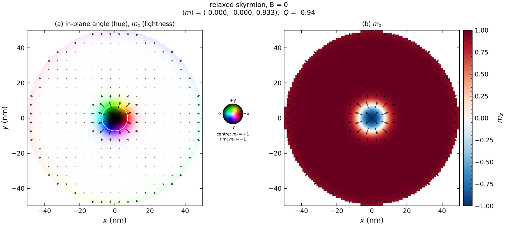
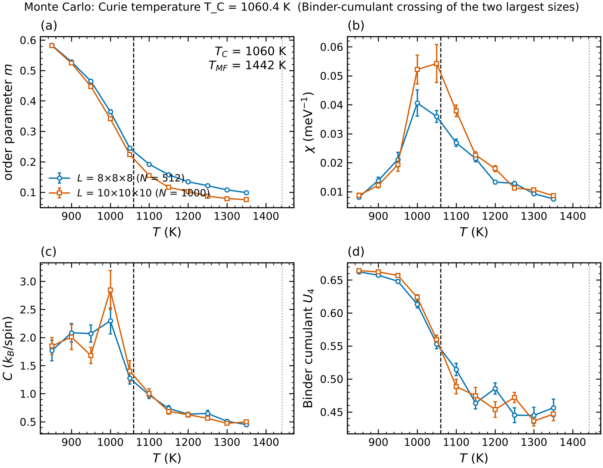
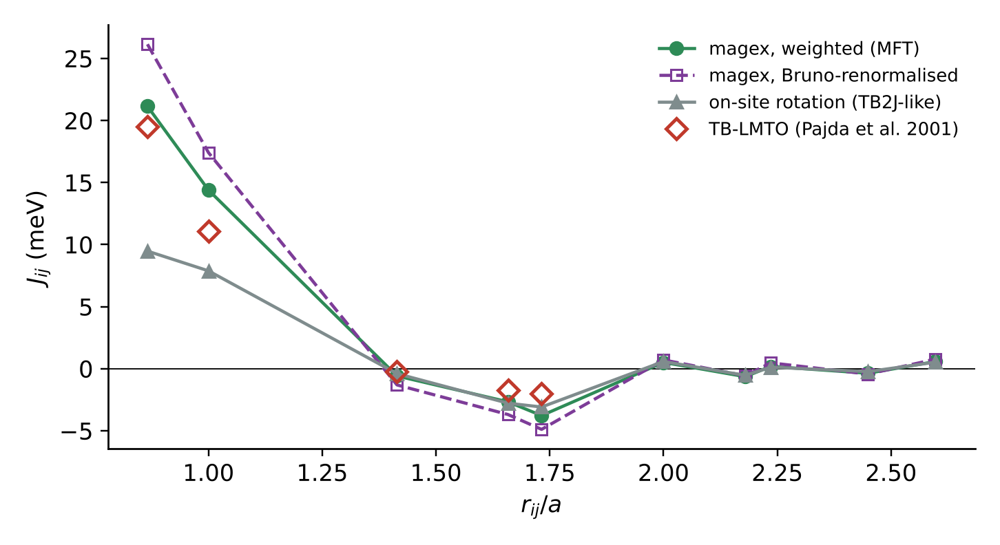
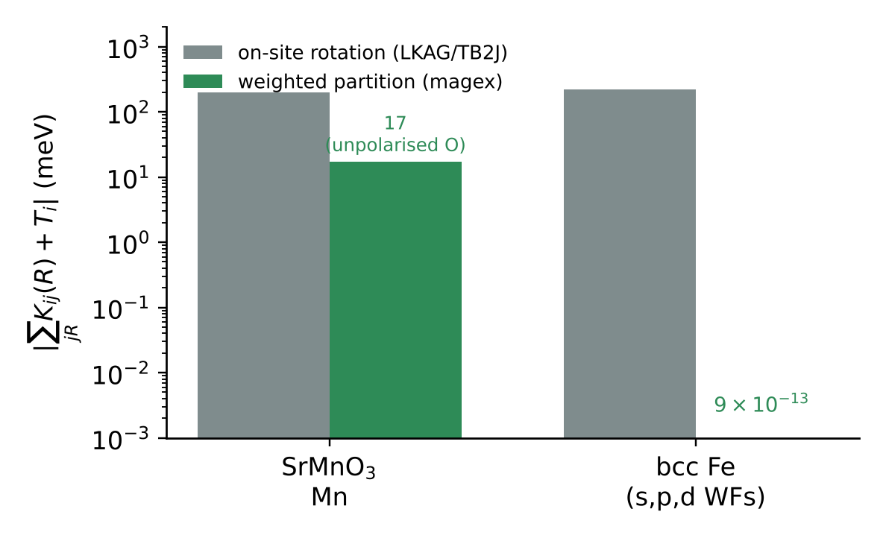
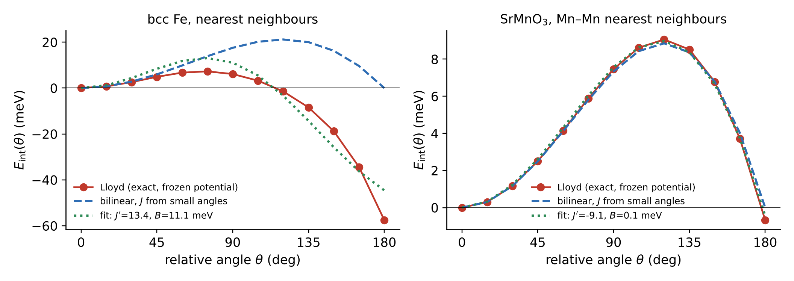

# magex

**From first principles to devices: magnetic exchange tensors from Wannier90 Hamiltonians, atomistic
spin dynamics (LLG), Monte Carlo ordering temperatures and finite-difference micromagnetics, in one
Python package. MPI/multithreaded on CPUs.**

[](https://github.com/Gokaran-Shukla/magex/actions/workflows/tests.yml)


```
 Wannier90 H(k) ─ magex run ─▶ results.json ─ magex llg ──▶ atomistic LLG, textures, topological charge
 (VASP / QE)                  J_ij tensors,  ─ magex mc ───▶ M(T), χ, C, Binder → T_C / T_N
                              DMI, SIA, μ    ─ magex params ▶ Ms, A, D, K ─ magex micromag ─▶ thin films,
                                                                     nanostructures, hysteresis, SOT
```

| engine | command | highlights |
|--------|---------|-----------|
| **Gilbert damping from DFT** | `magex damping` | torque-correlation α tensor vs broadening (intra/interband), anisotropy, MPI; feeds LLG and micromagnetics |
| **Fast T_C estimates** | `magex tc` | mean field, RPA (Tyablikov, multi-sublattice, anisotropy gap), quantum (S+1)/S |
| **Exchange from DFT** | `magex run` | rotationally invariant LKAG (sum rule to 1e-15), full 3×3 J + DMI + SIA from one run, Bruno renormalisation, ligand downfolding, Lloyd finite-angle energies, LSWT magnons |
| **Atomistic spin dynamics** | `magex llg` | stochastic LLG (Heun) with classical or quantum (Planck) thermostat, any lattice, full tensors, field off/on comparison, textures + topological charge, GIFs |
| **Magnon spectra** | `magex sqw`, stage `dispersion` | dynamical structure factor S(q,ω) from LLG vs LSWT; micromagnetic spin-wave dispersion with DMI non-reciprocity |
| **Energy barriers** | `magex gneb` | geodesic nudged elastic band with climbing image (atomistic and micromagnetic): skyrmion collapse, bit stability Δ, lifetimes |
| **Monte Carlo** | `magex mc` | vectorised Metropolis + over-relaxation (graph colouring), automatic FM/AFM/ferri order parameter, Binder crossing → T_C / T_N |
| **Micromagnetics** | `magex micromag` | OOMMF/mumax-style FD solver: Newell demag (FFT, PBC), exchange, interfacial/bulk DMI with chiral BCs, uniaxial/cubic anisotropy, SOT, RK45/Heun/BB, hysteresis, multilayers, OVF 2.0 |
| **Antiferro/ferri/altermagnets** | `[afm]` in `magex micromag` | two-sublattice micromagnetics: AFMR, chirality-split altermagnet magnons, SOT-driven AFM domain walls (relativistic contraction) |
| **Multiscale bridge** | `magex params` | A, D, K, Ms from the atomistic tensors (validated to 0.05 %) |
| **Interoperability** | `magex import-tb2j`, `magex export` | TB2J results into every magex engine; export to VAMPIRE, UppASD, Spirit, mumax³ |
| **Model Hamiltonians** | `magex model` | chain, square, triangular, honeycomb, kagome, sc, bcc, fcc with J shells, DMI, K |

<p align="center">
  <br>
  <em>Atomistic LLG on a triangular lattice with interfacial DMI: spin spirals with the field off, a Néel
  skyrmion lattice (Q = −11) at 2 T.</em>
</p>
<p align="center">
  
  <br>
  <em>Left: micromagnetic Néel skyrmion in a 100 nm Co/Pt disk. Right: Monte Carlo T_C of bcc Fe from
  the magex exchange (Binder crossing of two sizes).</em>
</p>

**Tutorials:** [`docs/tutorials`](docs/tutorials/README.md) — spin model, LLG and textures, Monte Carlo
T_C/T_N, micromagnetics (μMAG SP4), thin-film recipes (skyrmions, hysteresis, vortex, SOT, B20 helix,
multilayers), DFT → micromagnetics, Python API.

---

## Part I — exchange parameters from Wannier Hamiltonians

`magex` computes the parameters of the extended Heisenberg model

$$
E[\{\mathbf e\}] = \sum_i \mathbf e_i\cdot\mathsf A_i\cdot\mathbf e_i \;-\; \sum_{i\neq j}\mathbf e_i\cdot\mathsf J_{ij}\cdot\mathbf e_j ,
\qquad
\mathsf J_{ij} = J^{\rm iso}_{ij}\,\mathbb 1 + \mathsf J^{\rm ani}_{ij} + \mathsf J^{A}_{ij},\quad
\mathbf D_{ij} = (J^A_{yz}, J^A_{zx}, J^A_{xy})
$$

from a single DFT calculation, using the magnetic force theorem on a Wannier tight-binding Hamiltonian.
It is a from-scratch reimplementation of the Liechtenstein–Katsnelson–Antropov–Gubanov (LKAG) approach,
the method behind [TB2J](https://github.com/mailhexu/TB2J) (He *et al.*, Comput. Phys. Commun. **264**, 107938 (2021)),
rebuilt to remove the main limitations of the standard formulation.

<p align="center">
  
  
</p>

*Left: bcc Fe exchange vs. distance. The rotationally invariant scheme (green) recovers TB-LMTO
quality from an s,p,d Wannier Hamiltonian where on-site-only rotation (grey, TB2J-like) gives about half.
Right: the Goldstone sum rule, broken by 200 meV with on-site rotation, holds to machine precision.*

---

## Contents

- [What it computes](#what-it-computes)
- [What is different from the standard LKAG/TB2J scheme](#what-is-different-from-the-standard-lkagtb2j-scheme)
- [Installation](#installation)
- [Quick start](#quick-start)
- [Input reference](#input-reference)
- [Output](#output)
- [Recommended workflows](#recommended-workflows)
- [Parallel execution and performance](#parallel-execution-and-performance)
- [Theory in brief](#theory-in-brief)
- [Validation](#validation)
- [Limitations](#limitations)
- [Part II — spin dynamics, Monte Carlo and micromagnetics](#part-ii--spin-dynamics-monte-carlo-and-micromagnetics)
- [Repository layout](#repository-layout)
- [Citing](#citing)
- [Licence](#licence)

---

## What it computes

| Quantity | Details |
|---|---|
| **Isotropic exchange** $J^{\rm iso}_{ij}(\mathbf R)$ | all pairs inside the $N_1\times N_2\times N_3$ real-space supercell defined by the k-mesh |
| **Full 3×3 exchange tensor** $\mathsf J_{ij}$ | symmetric anisotropic part $\mathsf J^{\rm ani}$ and antisymmetric part (DMI vector $\mathbf D_{ij}$) |
| **Single-ion anisotropy** $\mathsf A_i$ | traceless 3×3 tensor per site, with easy axis |
| **Magnetocrystalline anisotropy** | band grand potential $\Omega(\hat{\mathbf n})$ for 8 directions and their opposites, quadratic fit, time-reversal check, and comparison with the anisotropy predicted by the fitted spin model |
| **Bruno-renormalised exchange** | moment-direction (constrained) exchange beyond the plain force theorem |
| **Ligand-downfolded exchange** | effective metal–metal couplings with spin-polarised ligands (O, I, Se, …) relaxed |
| **Finite-angle pair energies** | exact frozen-potential energies (Lloyd formula) for rotations up to 180°, fitted to bilinear + biquadratic terms, with a Heisenberg-validity measure per bond |
| **Orbital-resolved exchange** | $J_{mm'}$ matrices for selected shells |
| **Spin waves** | linear spin-wave theory with full tensors, DMI and single-ion anisotropy; band structure along any path |
| **Diagnostics** | charges and moments per site, Goldstone sum rule, reference-dependence residual of every tensor, symmetrisation change (Wannier-noise estimate), electron count of the Wannier manifold |

**Inputs:** Wannier90 `seedname_hr.dat` files, either collinear (`up`/`dn`, e.g. VASP `ISPIN=2`) or spinor (fully relativistic), plus `seedname.win` (cell, atoms, projections), optionally `seedname_centres.xyz` and a POSCAR. Works with Wannier Hamiltonians from VASP, Quantum ESPRESSO or any code interfaced to Wannier90, for bulk crystals, slabs and 2D materials.

## What is different from the standard LKAG/TB2J scheme

| Standard scheme | magex |
|---|---|
| Only the **on-site** block of the exchange field is rotated. In a Wannier basis, spin-dependent matrix elements also live *between* atoms and stay fixed, so rotating every spin is not a global rotation. The Goldstone sum rule fails (222 meV for bcc Fe with s,p,d Wannier functions) and $J$ is badly underestimated in itinerant magnets. | **Rotationally invariant partition** of the full exchange field among atoms (`partition = "weighted"`, default). The sum rule holds to $10^{-15}$. bcc Fe: $J_1 = 21.2$ meV and $T_{\rm MF} = 1427$ K, vs. TB-LMTO 19.5 meV and 1414 K; on-site rotation gives 9.5 meV and 441 K. The TB2J definition stays available (`partition = "onsite"`). |
| The full tensor, DMI and anisotropy need **three DFT runs** with spins along x, y and z, Wannierised separately, then merged. | **One DFT run.** The time-odd (exchange) part of the Hamiltonian is rotated relative to the lattice with spin–orbit coupling fixed, which gives three exact references from one Hamiltonian. All references are fitted jointly by least squares; the residual measures the reference dependence of each tensor. |
| No single-ion anisotropy from Wannier input. | **SIA tensors** $\mathsf A_i$ from on-site Hessians, consistent with all fitted $\mathsf J_{ij}$, plus a band MAE with a cross-check against the spin model. |
| SOC must come from a fully relativistic run. | **Atomic $\xi\,\mathbf L\cdot\mathbf S$** can be added to collinear Wannier Hamiltonians, with $\mathbf L$ built exactly in the Wannier90 real-harmonic basis (s, p, d, f); a default $\xi$ table can be overridden per element and shell. |
| $T = 0$ contour with a user-chosen lower bound $E_{\min}$; slow k-convergence in metals. | **Ozaki pole expansion** of the Fermi function at finite $T$: no $E_{\min}$, exponential convergence in the number of poles, smooth k-sums at $E_F$. The $T=0$ semicircle remains available. |
| Plain force theorem, valid only when spin-wave energies are small compared with the exchange splitting. | **Bruno renormalisation** (PRL **90**, 087205 (2003)): $\tilde K(\mathbf q) = -D\,K_b(\mathbf q)^{-1}D - D$. |
| Ligand moments ignored or treated as rigid. | **Ligand downfolding** in $\mathbf q$-space: $K_{\rm eff} = K_{MM} - K_{ML}K_{LL}^{-1}K_{LM}$. |
| Biquadratic terms estimated from small-angle formulas. | **Exact finite-angle Lloyd energies** $\Delta\Omega = \tfrac1\pi{\rm Im}\int f\,\ln\det(1-GV)$, fitted to bilinear + biquadratic terms. |
| Wannier noise unquantified. | **Space-group symmetrisation** (spglib) of every $\mathsf J_{ij}$ and $\mathsf A_i$; the size of the change is reported. |
| Magnons from isotropic $J$ only. | **LSWT** with full tensors, DMI and SIA; couplings at supercell-boundary ties are shared between images so the spin-wave Hamiltonian stays Hermitian. |

## Installation

```bash
git clone https://github.com/Gokaran-Shukla/magex.git
cd magex
pip install -e ".[mpi,sym]"     # numpy, scipy, mpi4py, spglib
```

Requirements: Python ≥ 3.10, numpy ≥ 1.22, scipy. Optional: `mpi4py` (MPI parallelism, needs an MPI library such as OpenMPI or MPICH), `spglib` ≥ 2 (symmetrisation), `matplotlib` (magnon plots). On Python 3.10 also install `tomli`.

Check the installation:

```bash
python -m pytest tests -q
```

## Quick start

1. Run DFT and Wannier90 with **atom-centred projections** and `write_xyz = true`, for example `Fe:s;p;d` or `Mn:d; O:p`.
2. Write `input.toml`:

```toml
[input]
win     = "Fe_up.win"
hr_up   = "Fe_up_hr.dat"
hr_dn   = "Fe_down_hr.dat"
centres = "Fe_up_centres.xyz"
efermi  = 12.6256            # eV, from the SCF run

[magnetic]
elements = ["Fe"]

[calc]
kmesh = [13, 13, 13]

[magnon]
path = "GHNGP"
special_points = {G=[0,0,0], H=[-0.5,0.5,0.5], N=[0,0,0.5], P=[0.25,0.25,0.25]}
```

3. Run:

```bash
magex run input.toml                                   # serial
OMP_NUM_THREADS=1 mpirun -n 40 magex run input.toml    # MPI
magex magnon input.toml                                # recompute magnons from results.json
```

Results go to `magex_results/`. Ready-to-edit inputs are in [`examples/`](examples).

## Input reference

All paths are relative to the input file.

### `[input]`

| key | default | meaning |
|---|---|---|
| `win` | required | `seedname.win`: `unit_cell_cart`, `atoms_frac`/`atoms_cart`, `projections` |
| `hr_up`, `hr_dn` | – | collinear Hamiltonians (spin up / down) |
| `hr` | – | spinor Hamiltonian (use instead of `hr_up`/`hr_dn`) |
| `centres` | – | `seedname_centres.xyz`; Wannier functions centred on periodic images are moved to the home cell |
| `poscar` | – | structure, if the `.win` has no cell or atom blocks |
| `spinor_order` | `"interleaved"` | `"interleaved"` (QE, VASP+W90: orbital-major, spin-minor) or `"blocked"` |
| `efermi` | 0.0 | Fermi energy in eV |
| `wf_centre_tol` | 0.6 | max. distance (Å) between a Wannier centre and its atom; larger stops the run |
| `tr_split` | true | split a spinor Hamiltonian into exchange (real) and SOC (imaginary) parts |

### `[magnetic]`

| key | default | meaning |
|---|---|---|
| `elements` | required | magnetic species, rotated as spin sites, e.g. `["Mn"]` |
| `ligands` | `[]` | spin-polarised ligands to include and downfold, e.g. `["O"]` |
| `ligand_min_field` | 0.005 | eV; ligands with a weaker on-site exchange field are ignored |

### `[soc_xi]` (optional)

Atomic SOC constants in eV, keyed `"Element:shell"`, e.g. `"Cr:d" = 0.035`, `"I:p" = 0.60`. Any entry here switches on atomic SOC for collinear input (`soc = "auto"`). Unlisted shells use the built-in table in `magex/orbitals.py`.

### `[calc]`

| key | default | meaning |
|---|---|---|
| `kmesh` | `[9, 9, 9]` | Γ-centred k-mesh; also the real-space supercell for $J(\mathbf R)$ |
| `contour` | `"ozaki"` | `"ozaki"` (finite T) or `"semicircle"` (T = 0) |
| `temperature` | 300 | K, electronic temperature of the Fermi function |
| `npole` | auto | number of Ozaki poles (auto: error < $10^{-10}$ over the band width) |
| `emin`, `nz` | auto, 120 | semicircle contour only |
| `partition` | `"weighted"` | `"weighted"` (rotationally invariant) or `"onsite"` (LKAG/TB2J; enables orbital decomposition) |
| `soc` | `"auto"` | `"none"`, `"atomic"` (add $\xi\mathbf L\cdot\mathbf S$), `"input"` (spinor SOC), `"replace"` (keep spinor exchange, replace its SOC by atomic SOC) |
| `refs` | `"auto"` | reference directions: x, y, z when SOC is present, otherwise the native axis; `"native"`; or a list like `[[1,0,0],[0,0,1]]` |
| `symmetrize` | true | space-group symmetrisation (needs spglib) |
| `bruno` | true | Bruno-renormalised exchange |
| `downfold` | true | ligand downfolding (when `ligands` are given) |
| `lloyd_shells` | 2 | finite-angle analysis for the first N distance shells (Ozaki contour) |
| `lloyd_angles` | 13 | angles between 0 and 180° |
| `orbital_shells` | 2 | orbital-resolved $J$ for the first N shells (`partition = "onsite"`) |
| `mae` | false | band-energy MAE (needs SOC) |
| `mae_kmesh` | `kmesh` | k-mesh for the MAE (use a dense one) |
| `nel` | – | fix the chemical potential by the electron count of the Wannier manifold |
| `rcut` | – | Å, print range in `exchange.out` (`results.json` keeps every pair) |
| `outdir` | `"magex_results"` | output directory |

### `[magnon]` (optional)

| key | default | meaning |
|---|---|---|
| `path` | `"GXMG"` | sequence of labels |
| `special_points` | required | fractional reciprocal coordinates of the labels |
| `npts` | 60 | points per segment |
| `J` | `"mft"` | isotropic part from `"mft"`, `"bruno"` or `"downfold"`; the anisotropic part and DMI always come from the tensor fit |
| `anisotropy` | true | include single-ion anisotropy |
| `axis` | last reference | ordering axis |

## Output

| file | contents |
|---|---|
| `exchange.out` | settings and conventions; per-site charges, moments and sum rule; $J$ (MFT, Bruno, downfolded) and DMI for every pair up to `rcut`; $\mathsf J^{\rm ani}$ with reference residuals; $\mathsf A_i$ with easy axes; Lloyd table with energies at every angle; MAE with time-reversal and Heisenberg cross-checks; orbital-resolved $J$; timings |
| `results.json` | everything in machine-readable form, all pairs in the supercell, full tensors |
| `pairs.csv` | one row per pair: $J^{\rm iso}$, corrected $J$, $\mathbf D$, all nine tensor components |
| `magnon_band_<J>.dat`, `.png` | LSWT bands along the path |

**Convention** (identical to TB2J): unit spins, every ordered pair counted once ($\mathsf J_{ji} = \mathsf J_{ij}^T$), $J > 0$ ferromagnetic, energies in meV, $\mathbf R$ in lattice units.

## Recommended workflows

**Isotropic exchange only (no SOC).** Collinear run (`ISPIN=2`), up/down Wannier90 Hamiltonians. See [`examples/bccFe.toml`](examples/bccFe.toml) and [`examples/SrMnO3.toml`](examples/SrMnO3.toml).

**DMI, anisotropic exchange, SIA and MAE.** Recommended: a *collinear* run plus atomic SOC on the Wannier orbitals ([`examples/collinear_plus_soc.toml`](examples/collinear_plus_soc.toml)). The exchange/SOC separation is then exact at model level, and one calculation gives all references. Fit `[soc_xi]` to a fully relativistic band structure for quantitative work.

**Spinor input.** One fully relativistic run ([`examples/spinor.toml`](examples/spinor.toml)). Separating exchange from SOC assumes a nearly real Wannier gauge. Check the *time-reversal* line of the MAE section; if $|E(\hat{\mathbf n}) - E(-\hat{\mathbf n})|$ is not small, use `soc = "replace"` or the collinear route.

**Wannierisation tips.** Use atom-centred projections that cover all spin-polarised states (metal d, ligand p), `write_xyz = true`, and a frozen window that reproduces the occupied bands. Bond-centred MLWFs cannot be assigned to atoms; the code stops if a centre is more than `wf_centre_tol` from its atom. Local-axis projections (`:z=`/`:x=`) are not supported yet.

## Parallel execution and performance

- **MPI over k-points** for the eigen-decomposition (block-cyclic), then **MPI over energy nodes** for the integration, with one `Allreduce` at the end. Results match serial runs to $10^{-14}$.
- Use one rank per core with `OMP_NUM_THREADS=1`. For very large Wannier bases, use fewer ranks with more BLAS threads (e.g. 10 × 4 on 40 cores).
- Green's functions use the spectral form $G(\mathbf k,z) = \Psi\,{\rm diag}(1/(z-\varepsilon))\,\Psi^\dagger$ (no matrix inversion per energy) and an FFT to real space.
- Memory of the weighted engine scales as about $10\,N_k N_{\rm sel} N_{\rm wann}$ complex numbers per rank ($N_{\rm sel}$ = orbitals on spin sites).
- Example: bcc Fe (18 WFs, $13^3$ k, finite-angle analysis for two shells) takes 2.7 min on 2 ranks; SrMnO₃ (28 WFs per spin, $5^3$) takes 35 s serial and 19 s on 2 ranks.

A SLURM template for a 40-core node is in [`examples/slurm_40cores.sh`](examples/slurm_40cores.sh).

## Theory in brief

A full derivation of every formula, with proofs, is in the slide deck [`docs/magex_theory_slides.pdf`](docs/magex_theory_slides.pdf) (LaTeX source in `docs/slides_src/`).

**Model.** Every Hamiltonian is stored as $H(\mathbf R) = H_0(\mathbf R)\otimes 1 + \sum_c [X_c(\mathbf R) + S_c(\mathbf R)]\otimes\sigma_c$, with $X$ the time-odd exchange field and $S$ the time-even SOC.

**Perturbation.** Rotating site $i$'s exchange field about axis $\mathbf e_a$ gives $W_{ia} = \Pi_i Y_a + Y_a^\dagger\Pi_i$ with $Y_a = (\mathbf e_a\times X_L)\cdot\boldsymbol\sigma$. Here $X_L$ assigns each inter-atomic exchange element to the two atoms with weights $w_a/(w_a+w_b)$, where $w$ is the on-site field strength. The pieces add up to the full $X$, so a uniform rotation is a true global rotation.

**Hessian.** From the Lloyd formula and the force theorem,

$$
K_{ab}(i,j,\mathbf R) = \frac{\partial^2\Omega}{\partial\phi_{ia}\partial\phi_{jb}}
= -\frac1\pi\,{\rm Im}\int d\varepsilon\, f(\varepsilon)\,{\rm Tr}\big[W_{ia}\,G_{ij}(\mathbf R)\,W_{jb}\,G_{ji}(-\mathbf R)\big],
$$

evaluated with Ozaki poles, $-\tfrac1\pi{\rm Im}\int fF = 2k_BT\sum_p R_p\,{\rm Re}\,F(\mu + iz_pk_BT)$. On-site Hessians add ${\rm Tr}[\rho_{ii}\,\partial^2 H_i]$.

**Mapping.** $K_{ab}(i,j,\mathbf R) = -2\,(\mathbf e_a\times\mathbf n_i)\cdot\mathsf J_{ij}(\mathbf R)\cdot(\mathbf e_b\times\mathbf n_j)$. Three reference directions give 12 equations for the 9 tensor components, solved by least squares; on-site Hessians give $\mathsf A_i$.

**Beyond MFT.** Bruno: $\tilde K = -DK_b^{-1}D - D$. Downfolding: Schur complement over ligand sites. Finite angles: $\Delta\Omega_S = \tfrac1\pi{\rm Im}\int f\ln\det(1 - G_{SS}V_{SS})$, with pair energy $E_{\rm int}(\theta) = 4sJ'c(1-c) - 2B\cos\theta(\cos\theta - 1)$, $c = \cos(\theta/2)$.

**Spin waves.** Holstein–Primakoff in local frames; energies are the positive eigenvalues of ${\rm diag}(1,-1)\,h(\mathbf k)$. For one ferromagnetic sublattice, $\omega(\mathbf q) = \tfrac4M[J(0) - J(\mathbf q)]$.

## Validation

Run `python -m pytest tests`. Every formula is checked against brute force:

| test | result |
|---|---|
| Green's-function Hessian vs. exact finite differences of $\Omega$ (random cluster with SOC, AFM order, spin-dependent hopping) | max error $1.5\times10^{-7}$ (finite-difference limit) |
| Weighted partition vs. exact finite differences | $1.3\times10^{-7}$ |
| k-mesh/FFT vs. explicit Γ-only supercell | $9\times10^{-16}$ |
| Lloyd finite-angle energies vs. exact $\Omega$ (both partitions) | ≤ $2.5\times10^{-11}$ eV |
| Goldstone sum rule (weighted partition) | $4\times10^{-15}$ |
| Heisenberg mapping round trip (tensors and SIA) | $7\times10^{-16}$ |
| LSWT: ferromagnetic chain, antiferromagnetic chain, anisotropy gap | analytic |
| MPI (2 ranks) vs. serial | identical to $10^{-14}$ |

**Physical checks** on the [TB2J example data](https://github.com/mailhexu/TB2J_examples); outputs are in [`validation_runs/`](validation_runs):

| system | result |
|---|---|
| **SrMnO₃** (G-AFM, VASP) | $J_1 = -8.54$ meV, converged at $7^3$ k; TB2J 0.9.22 gives −8.33 meV at $17^3$. The $t_{2g}$ channel is identical and the difference sits in the $e_g$ channel; magex matches exact energy differences of the same Hamiltonian (−66.571 vs. −66.565 meV) |
| **bcc Fe** (QE, s,p,d WFs) | weighted: $J_1 = 21.2$, $J_2 = 14.4$ meV, $T_{\rm MF} = 1427$ K (TB-LMTO 19.5 meV, 1414 K; exp. 1043 K). On-site: 9.5 meV, 441 K (TB2J 0.9.22: 8.8 meV). Magnon maximum 542 meV at H |
| **CrI₃** (spinor VASP) | single-run tensors self-consistent to 3%, vs. up to 35% scatter between three separately Wannierised runs. Easy axis $z$; MAE 0.71 meV/cell (band) vs. 0.78 meV/cell (spin model) with atomic SOC |
| **Finite angles** | SrMnO₃ bonds are Heisenberg-like up to 180°; bcc Fe nearest neighbours are strongly non-Heisenberg at large angles |

<p align="center">
  
</p>

## Limitations

- Frozen-potential (non-self-consistent) force theorem; adiabatic magnons; collinear reference states.
- Spinor input relies on a nearly real Wannier gauge to separate exchange from SOC; the code reports a time-reversal check, and the collinear + atomic SOC route avoids the issue.
- Bruno renormalisation and downfolding act on the isotropic channel of one reference; Bruno is applied within the magnetic subspace.
- Local-axis projections and `random` projections in the `.win` are not supported.
- Orbital-resolved $J$ is available with `partition = "onsite"` only.
- CPU only. Memory of the weighted engine grows with $N_k\times N_{\rm wann}$.

## Part II — spin dynamics, Monte Carlo and micromagnetics

Full documentation: [`docs/tutorials`](docs/tutorials/README.md); inputs: [`examples/spindyn`](examples/spindyn),
[`examples/micromag`](examples/micromag).

```bash
magex llg  examples/spindyn/skyrmion_llg.toml     # atomistic skyrmions, field off vs on
magex mc   examples/spindyn/fe_mc.toml            # Curie temperature of bcc Fe
magex mc   examples/spindyn/srmno3_mc.toml        # Neel temperature of SrMnO3
magex micromag examples/micromag/sp4.toml         # muMAG standard problem 4
magex micromag examples/micromag/skyrmion_disk.toml
magex params validation_runs/CrI3_atomic_soc/results.json.gz
```

### Atomistic LLG (`[llg]`)

`de/dt = −γ/(1+α²)[e × B + α e × (e × B)]` with the Brown thermal field; B from the full magex
Hamiltonian (3×3 J tensors, DMI, single-ion anisotropy, Zeeman).  `compare_field = true` runs the same
initial state with the field off and on and plots both textures side by side; the topological charge is
computed on any lattice from a periodic Delaunay triangulation.  Outputs: textures (PDF + PNG), time
series, spins (npz/csv), GIF.

### Monte Carlo (`[mc]`)

Metropolis with adaptive moves and over-relaxation, simultaneous updates of non-interacting sites,
temperatures in parallel processes.  The order parameter (magnetisation or Néel vector) is set from
the magex reference; T_C / T_N from the Binder-cumulant crossing of two sizes, with χ and C peaks as
cross-checks.  The J(q) stability check warns when the coupling cut-off makes a spiral the ground state.

### Micromagnetics (`magex micromag`)

| feature | details |
|---------|---------|
| mesh | rectangular FD mesh, open or periodic axes, regions with their own material, multilayers |
| geometry | rectangle, disk, ellipse, ring, triangle, polygon, PNG mask, holes, rotation, z-ranges |
| energy terms | exchange (harmonic mean at interfaces, inter-region scaling), demag (Newell tensor, FFT, PBC images), Ku1/Ku2, cubic Kc1, interfacial and bulk DMI with chiral boundary conditions, Zeeman (static, pulse, ac, sinc, non-uniform) |
| torques | spin-orbit torque (damping-like + field-like, pulsed or arbitrary waveform) |
| solvers | adaptive Dormand–Prince RK45, stochastic Heun at T > 0, Barzilai–Borwein minimiser, relax, hysteresis |
| output | OVF 2.0 (binary/text, OOMMF/mumax compatible), tables, HSL + m_z figures, movies, spectra, loops |
| materials | Py, Co/Pt, Pt/Co/AlOx, CoFeB, Ta/CoFeB/MgO, Fe, Ni, hcp Co, YIG, FeGe, MnSi, Fe3GeTe2, CrI3 |

### Validation of the dynamics engines

| check | result |
|-------|--------|
| Larmor frequency γB | exact (10⁻⁶) |
| thermal LLG / MC vs Langevin function | within statistics |
| SC Heisenberg FM T_C (exact 33.49 K) | 33.29 K |
| SC Heisenberg AFM T_N | 32.6 K |
| demag tensor sum rules | 10⁻¹² |
| Bloch wall energy 4√(AK) | 0.06 % |
| DMI wall energy 4√(AK) − π\|D\| | 0.03 % |
| μMAG SP4: s-state ⟨m⟩, first ⟨m_x⟩ = 0 | (0.9670, 0.1253, 0), 0.136 ns (ref. ≈ 0.137 ns) |
| atomistic → continuum A, D | 0.05 % |

Real materials, from the exchange bundled in `validation_runs/` (`examples/spindyn/*_mc.toml`):

| material | quantity | magex (classical MC) | experiment |
|----------|----------|----------------------|------------|
| bcc Fe (MFT exchange, rcut 11 Å) | T_C | 1060 K (Binder 8³/10³; χ peak 1031 K) | 1043 K |
| SrMnO3 (G-type AFM) | T_N | 192 K (Binder 6³/8³; χ peak 207 K) | 233–260 K |
| CrI3 monolayer (anisotropic J + SIA) | T_C | 20 K (classical spins) | 45 K |

Classical spins underestimate T_C for small S; the RPA/quantum rescaling (S+1)/S brings CrI3 (S = 3/2)
to ≈ 34 K.  For bcc Fe the full-range couplings are essential: truncation at 5–6 Å gives a spiral
ground state (flagged by the J(q) check) and 8 Å gives T_C ≈ 650 K.


## Repository layout

```
magex/
  io_w90.py           Wannier90 readers (hr, centres, win, eig) and POSCAR
  model.py            spinor TB model: H0 + (X + S).sigma, rotations, atomic SOC, W90 loader
  orbitals.py         L matrices in the W90 real-harmonic basis, L.S, default xi table
  contour.py          Ozaki pole expansion and semicircle contour
  engine.py           on-site (LKAG) Green's-function engine, Lloyd, orbital decomposition
  engine_partition.py rotationally invariant (weighted) engine, Lloyd with non-local V
  heisenberg.py       Hessian -> J tensors, DMI, SIA; minimal images
  symmetry.py         spglib symmetrisation
  renorm.py           Bruno renormalisation, ligand downfolding (q-space)
  analysis.py         Lloyd fits, band MAE, anisotropy fits
  magnon.py           linear spin-wave theory
  parallel.py         MPI helpers (serial fallback)
  driver.py           workflow
  output.py, cli.py   exchange.out / json / csv writers, command line
  spinmodel.py        results.json -> supercell spin Hamiltonian (sparse), J(q) check, mean-field T_C
  llg.py, texture.py  stochastic LLG (Heun), texture plots, topological charge, GIFs
  montecarlo.py       Metropolis + over-relaxation, graph colouring, Binder analysis
  models.py           model lattices (chain ... fcc) with J shells, DMI, anisotropy
  plotstyle.py        publication figure style (PDF + 300 dpi PNG, colour-blind safe)
  micromag/           finite-difference micromagnetics: mesh, demag, system, solver, io (OVF), plot,
                      materials, bridge (atomistic -> continuum), driver
tests/                exactness tests (exchange engines, LLG, MC, micromagnetics)
examples/             exchange inputs, spindyn/ (LLG, MC), micromag/ (thin films, devices)
validation_runs/      outputs for SrMnO3, bcc Fe, CrI3 (results.json.gz used by the examples)
docs/                 theory slides, tutorials/
```

## Citing

If you use magex, please cite this repository (see [`CITATION.cff`](CITATION.cff)) and the method papers:

- A. I. Liechtenstein, M. I. Katsnelson, V. P. Antropov, V. A. Gubanov, J. Magn. Magn. Mater. **67**, 65 (1987)
- V. P. Antropov, M. I. Katsnelson, A. I. Liechtenstein, Physica B **237–238**, 336 (1997)
- P. Bruno, Phys. Rev. Lett. **90**, 087205 (2003)
- T. Ozaki, Phys. Rev. B **75**, 035123 (2007)
- X. He, N. Helbig, M. J. Verstraete, E. Bousquet, Comput. Phys. Commun. **264**, 107938 (2021) (TB2J)

and, for the dynamics engines,

- A. J. Newell, W. Williams, D. J. Dunlop, J. Geophys. Res. **98**, 9551 (1993) (demag tensor)
- A. Vansteenkiste *et al.*, AIP Advances **4**, 107133 (2014) (mumax³ conventions)
- R. F. L. Evans *et al.*, J. Phys.: Condens. Matter **26**, 103202 (2014) (atomistic spin dynamics)
- K. Binder, Z. Phys. B **43**, 119 (1981) (cumulant method)

## Licence

MIT, see [`LICENSE`](LICENSE). The validation runs use the public [TB2J example data](https://github.com/mailhexu/TB2J_examples); that data is not redistributed here.
