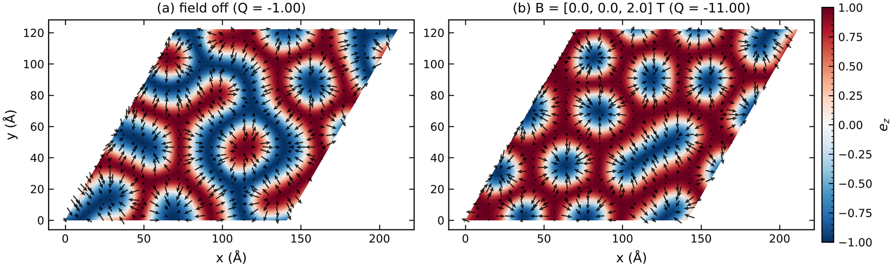
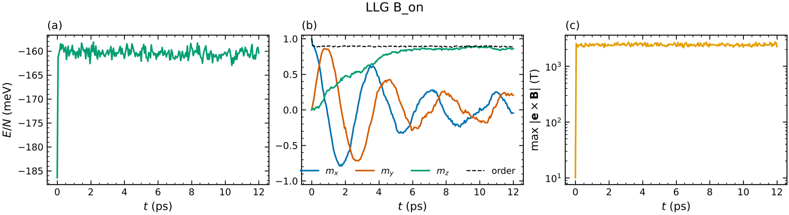

# 2 · Atomistic LLG spin dynamics and real-space textures

```bash
cd examples/spindyn
magex llg skyrmion_llg.toml
```

```toml
[spinmodel]
model = {lattice = "triangular", a = 3.0, J = [2.0], D = 1.0, dmi = "interfacial", moment = 3.0}
supercell = [48, 48, 1]
pbc = [true, true, false]

[llg]
alpha = 0.5               # Gilbert damping
dt = 2e-3                 # ps
steps = 15000
field = [0, 0, 2.0]       # T
compare_field = true      # run B = 0 first, then B = field, same initial state -> side-by-side figure
init = "random"           # random | ferro | reference | reference_axis | file
anneal = {T_start = 30.0, steps = 5000}   # linear cooling before the production run
torque_tol = 1e-3         # stop at T = 0 once max |e x B| < tol (T)
gif = true
outdir = "skyrmion_llg"
```

Output (`skyrmion_llg/`):

| file | content |
|------|---------|
| `texture_B_off.png/.pdf`, `texture_B_on.png/.pdf` | layer map: smooth e_z colour map + in-plane arrows, topological charge Q in the title |
| `texture_compare.png/.pdf` | field off vs field on |
| `timeseries_B_*.png` | E/N, ⟨m⟩, order parameter, max torque vs time |
| `llg_B_*.csv` | the same as a table |
| `spins_B_*.npz/.csv` | final spins + positions (reload with `init = "file"`) |
| `dynamics_B_*.gif` | animation |



With the field off the DMI produces a labyrinth of spin spirals; 2 T condenses it into a lattice
of Néel skyrmions (Q = −11 for 48×48 sites).  Q is computed with Berg–Lüscher solid angles on a
periodic Delaunay triangulation of the layer, so it is an integer for smooth textures and works
on any lattice (triangular, honeycomb, kagome, …).

## Other options

| key | meaning |
|-----|---------|
| `temperature` | K; Langevin thermal field (Brown) |
| `precession = false` | pure damping (fast relaxation) |
| `plane`, `layer` | which atomic layer to draw (`xy`, `xz`, `yz`; layer index, negative from the top) |
| `snapshots` | number of stored frames for the GIF |
| `init_file` | spins_*.npz from a previous run |
| `magex llg file.toml --field 0 0 3` | override the field from the command line |

## Real materials

* `cri3_llg.toml` — CrI3 monolayer at 15 K with first-principles anisotropic exchange and SIA; field
  off vs 1 T.
* `fe_llg_relax.toml` — bcc Fe at 300 K, magnetisation started along x in a 10 T field along z:
  damped Larmor precession with period 2π/(γB) = 3.6 ps.



## Choosing dt

The fastest precession is set by the exchange field B_ex ≈ 2 Σ_j J_ij /(μ μ_B); use
γ B_ex dt ≲ 0.05.  For bcc Fe (B_ex of a few thousand T) dt = 0.5 fs, for CrI3 / model systems 2 fs.
