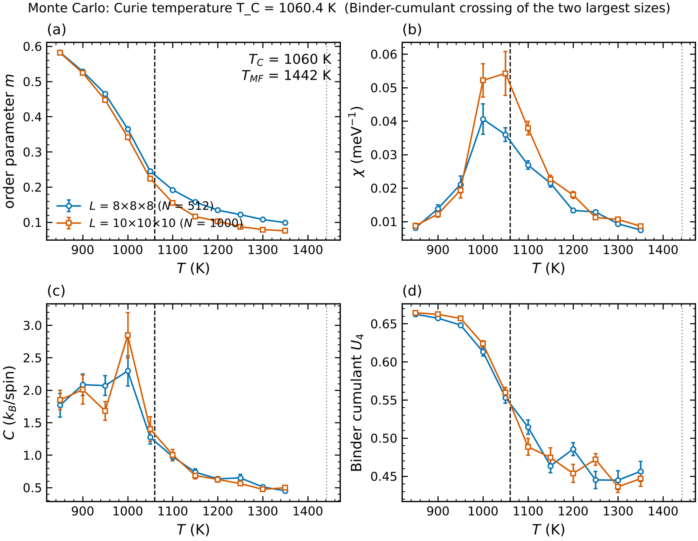
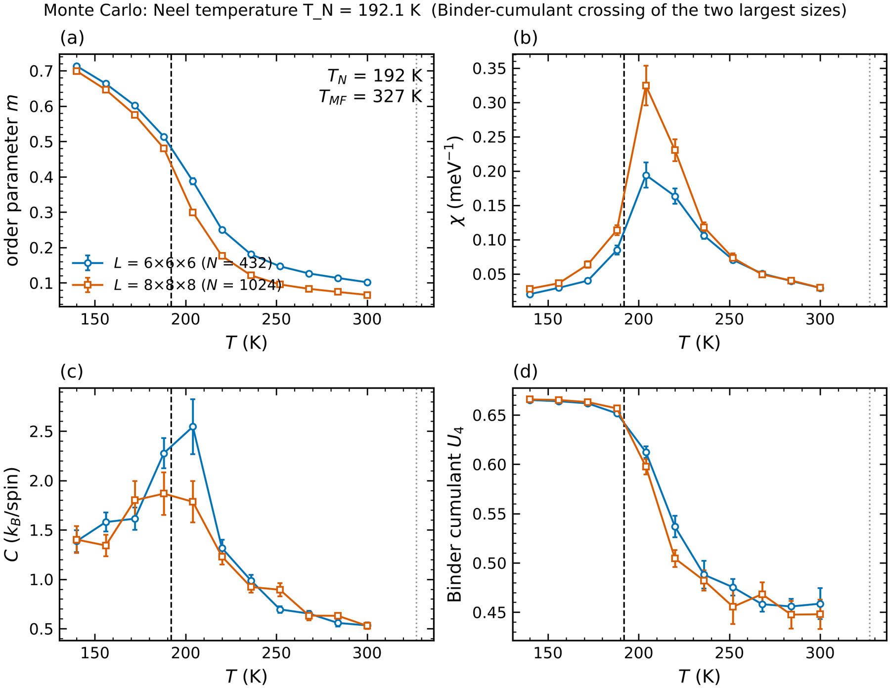

# 3 · Monte Carlo: Curie and Néel temperatures

```bash
cd examples/spindyn
magex mc fe_mc.toml        # bcc Fe      -> T_C
magex mc srmno3_mc.toml    # SrMnO3      -> T_N  (G-type AFM)
magex mc cri3_mc.toml      # CrI3 layer  -> T_C  (anisotropy keeps T_C finite in 2D)
```

```toml
[spinmodel]
results = "../../validation_runs/bccFe_weighted/results.json.gz"
rcut = 11.0

[mc]
sizes = [[8, 8, 8], [10, 10, 10]]                 # >= 2 sizes for the Binder crossing
temperatures = {start = 850, stop = 1350, n = 11} # or a list, or "auto" (0.25-1.15 T_MF)
therm_sweeps = 800
meas_sweeps = 1600
sample_every = 2
field = [0, 0, 0]
nproc = 2                                         # temperatures run in parallel processes
outdir = "fe_mc"
```

The order parameter is chosen automatically from the magex reference state: magnetisation for a
ferromagnet, the staggered (Néel) vector for antiferro- and ferrimagnets.  Measured at every
temperature: E, C = (⟨E²⟩−⟨E⟩²)/(N k_B T²), m, χ = N(⟨m²⟩−⟨m⟩²)/(k_B T), Binder cumulant
U₄ = 1 − ⟨m⁴⟩/(3⟨m²⟩²), all with 10-bin error bars.

Output: `mc_results.csv`, `tc_estimate.json` and `mc_observables.png/.pdf` (four panels: m, χ, C, U₄).





## How T_C / T_N is extracted

1. Binder crossing of consecutive sizes (finite-size-independent at T_C up to corrections);
2. otherwise the χ peak of the largest size (shifts as L^(−1/ν)), and the C peak as a cross-check.

`tc_estimate.json` contains all three, plus the mean-field value.

## Benchmarks

| system | magex MC | exact / experiment |
|--------|----------|--------------------|
| SC Heisenberg FM (J = 1 meV/pair) | 33.29 K | 33.49 K (high-precision MC) |
| SC Heisenberg AFM | 32.6 K | 33.49 K |
| bcc Fe (MFT exchange, rcut 11 Å, L = 8, 10) | 1060 K (χ peak 1031 K), 8.5 min on 2 cores | 1043 K |
| SrMnO3 (G-AFM, L = 6, 8) | 192 K (χ peak 207 K) | 233–260 K |
| CrI3 monolayer (L = 12, 18) | 20 K (classical) | 45 K |

**Cut-off matters in metals.** For bcc Fe: rcut 5–6 Å makes a spiral the ground state (J(q) warning),
rcut 8 Å stops inside a negative RKKY shell and gives T_C ≈ 650 K, the full range (11 Å, 20 shells)
gives 1060 K.  Always converge T_C with rcut and keep the supercell width above 2 rcut.

Classical MC with MFT exchange is known to place T_C of metals within ~10–20 % of experiment;
quantum (S-finite) corrections can be added by rescaling T with (S+1)/S (Tyablikov / RPA).

## Tips

* use the same seed and more sweeps near T_C; `refine = true` adds points around the χ peak;
* ultrathin films need `pbc = [true, true, false]` and anisotropy (Mermin–Wagner);
* field sweeps: run at fixed T with `field = [...]` to obtain M(B) curves.
