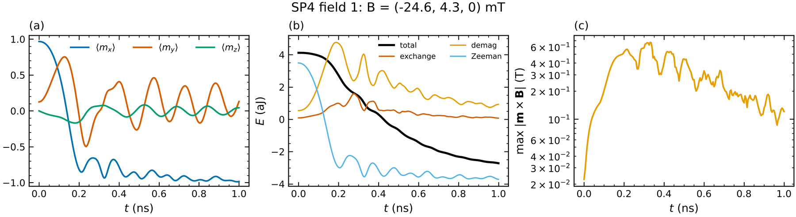

# 4 · Micromagnetics: the first simulation (μMAG standard problem 4)

`magex micromag` is a finite-difference micromagnetic solver in the spirit of OOMMF and mumax³,
written in NumPy/SciPy (multithreaded FFTs), with the same energy terms, units and file formats.

```bash
cd examples/micromag
magex micromag sp4.toml
```

```toml
[mesh]
n = [128, 32, 1]                      # cells
cell_nm = [3.90625, 3.90625, 3.0]     # keep cells below the exchange length (printed at start)
# pbc = [false, false, false]         # periodic axes (thin films: [true, true, false])

[[region]]                            # one or more regions; later regions override earlier ones
material = "Py"                       # library entry (see below) ...
alpha = 0.02                          # ... with any parameter overridden

[init]
type = "uniform"
direction = [1, 0.1, 0.01]

[[stage]]                             # stages run in order on the same magnetisation
type = "relax"

[[stage]]
type = "run"
B = [-0.0246, 0.0043, 0.0]            # tesla
time_ns = 1.0
record_ps = 5
tol = 1e-6                            # RK45 error tolerance (max |Δm| per step)
movie = true

[output]
dir = "sp4_out"
```

Start-up summary:

```
Mesh 128x32x1 cells of 3.90625x3.90625x3 nm^3 (500 x 125 x 3 nm^3), pbc=(False, False, False)
  magnetic cells 4096 / 4096, regions: ['Py']
  exchange length l_ex = 5.69 nm  (cell 3.90625 nm)
  demag kernel (256, 64, 1), cell factors Nxx,Nyy,Nzz = [0.3031, 0.3031, 0.3939]
```

Result: s-state ⟨m⟩ = (0.9670, 0.1253, 0.0000) and the first zero of ⟨m_x⟩ at 0.136 ns, matching the
published SP4 solutions.



## Stages

| type | what it does | keys |
|------|--------------|------|
| `relax` | damping-only dynamics (escapes saddle points) then Barzilai–Borwein minimisation | `torque_tol` (T, default 1e-5) |
| `minimize` | BB minimisation only (fastest; may stop in a saddle of a symmetric start) | `torque_tol` |
| `run` | LLG with adaptive Dormand–Prince RK45 | `time_ns`, `record_ps`, `tol`, `movie`, `movie_ps`, `spectrum` |
| `thermal` | stochastic LLG (Heun, Brown thermal field) | `time_ns`, `T_K`, `dt_fs`, `seed` |
| `hysteresis` | quasi-static loop with minimisation at each field | `Bmax_T`, `npts`, `direction`, `branch` |

Any stage may set `B = [...]` (new static field from then on) and `alpha` (for this stage only).

## Outputs

* `m_<stage>.png/.pdf` – two panels: HSL colour (hue = in-plane angle, lightness = m_z, with a colour
  wheel) and m_z map, arrows, white m_z = 0 contour, ⟨m⟩ and topological charge Q in the title;
* `m_<stage>.ovf` – OVF 2.0 binary-8, readable by OOMMF/mumax/ParaView/muview/Ubermag;
* `table_<stage>.txt/.png` – t, ⟨m⟩, energies by term, max torque, field;
* `movie_<stage>.gif`, `loop_<stage>.txt/.png`, `spectrum_<stage>.png`;
* `summary.json` – ⟨m⟩, Q and energies after each stage.

## Material library

`Py, Co/Pt, Pt/Co/AlOx, CoFeB, Ta/CoFeB/MgO, Fe, Ni, Co_hcp, YIG, FeGe, MnSi, Fe3GeTe2, CrI3`
(`magex.micromag.MATERIALS`).  Parameters (SI): `Ms` (A/m), `A` (J/m), `D` (J/m²) with
`dmi = "interfacial" | "bulk"`, `Ku1`, `Ku2` (J/m³) along `anisU`, `Kc1` (J/m³) with axes `anisC1`,
`anisC2`, `alpha`.

## Fields

```toml
[field]
B = [0, 0, 0.1]                                  # static
pulse = {B = [0.05, 0, 0], t0_ns = 0.1, width_ns = 0.05}
# ac   = {B = [0.001, 0, 0], f_GHz = 10}
# sinc = {B = [0.001, 0, 0], fmax_GHz = 50, t0_ns = 0.05}   # broadband, use with spectrum = true
```

## Performance

On two CPU cores: 100×100 cells with demag ≈ 12 ms per field evaluation (6 per RK45 step).
Set `[demag] enabled = false` for ultrathin films where an effective anisotropy
K_eff = K_u − μ₀M_s²/2 is used instead.
