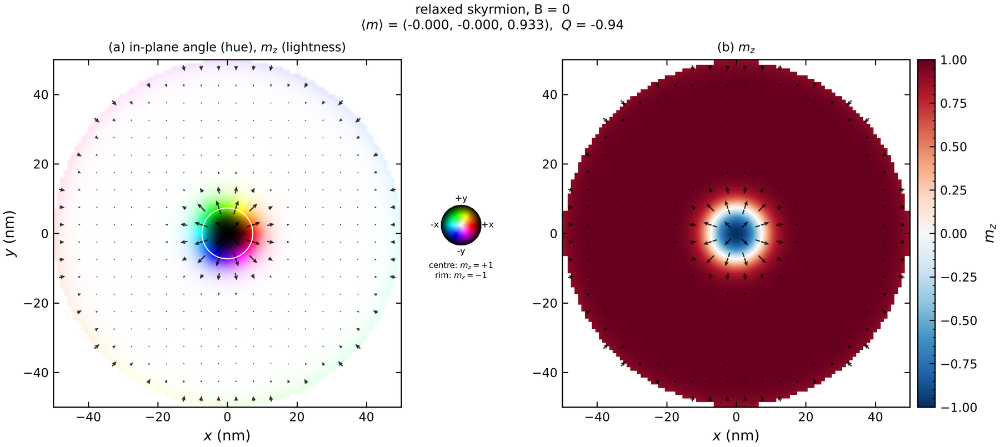
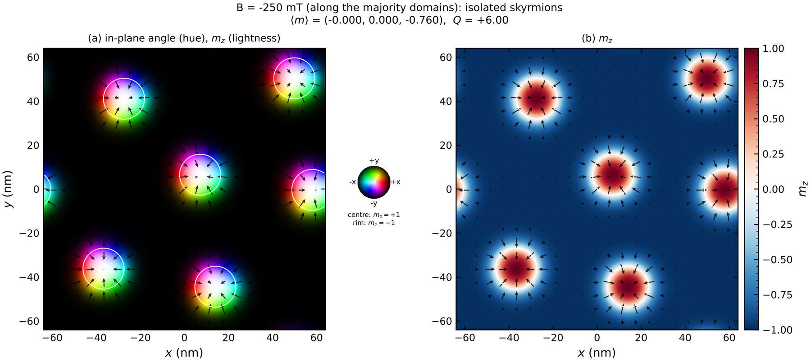
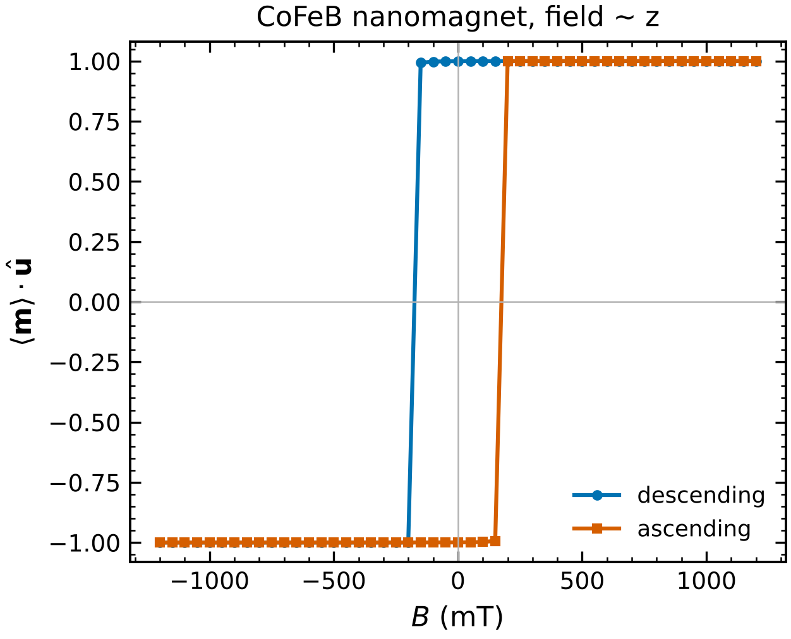
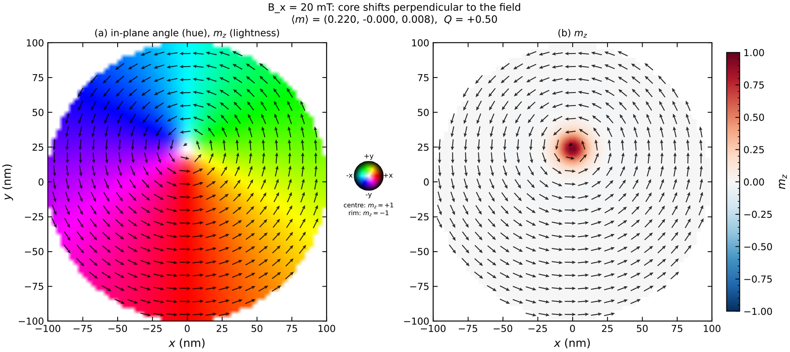
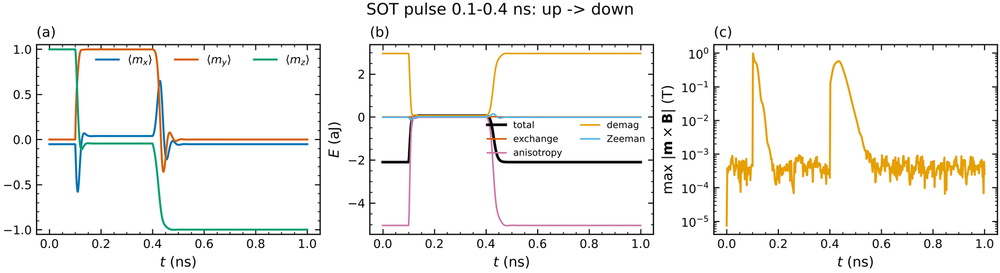
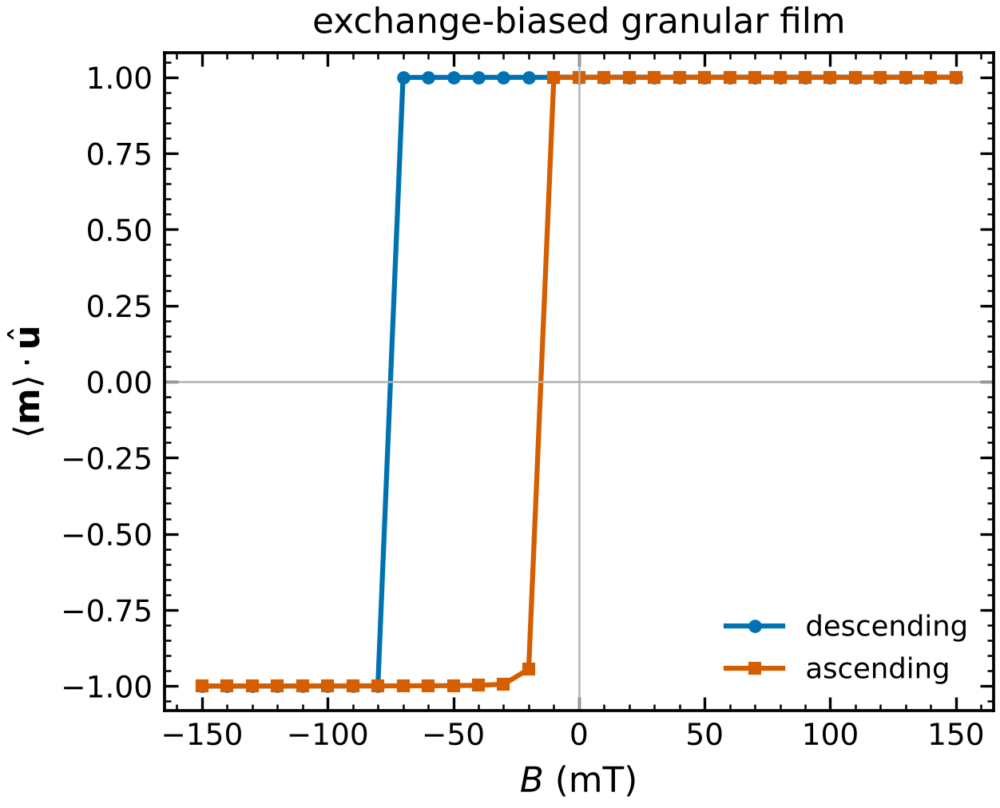

# 5 · Thin-film recipes

All inputs are in `examples/micromag/`; each runs with `magex micromag <file>.toml`.

## Geometry

```toml
[[region]]
material = "Co/Pt"
shape = "disk"          # rectangle | disk | ellipse | ring | triangle | polygon | png
diameter_nm = 100       # disk;  ellipse: diameters_nm = [a, b];  ring: outer_nm, inner_nm
center_nm = [0, 0]      # rectangle: size_nm = [lx, ly];  polygon: vertices_nm = [[x, y], ...]
rotate_deg = 0
z_layers = [0, 0]       # cell range along z (multilayers)
subtract = [{shape = "disk", diameter_nm = 20}]     # holes / antidots
# shape = "png", path = "mask.png"                 # dark pixels = magnet, stretched over the mesh
```

Cells outside every region are empty (M_s = 0); the free-surface boundary conditions are applied at
the edges of every region, including holes.

## Isolated skyrmion in a Co/Pt disk — `skyrmion_disk.toml`

PMA + interfacial DMI below the spiral threshold (|D|/D_c = 0.79 is printed): a skyrmion is metastable
and the DMI cants the edge magnetisation.  The second stage applies +200 mT along the background and
the skyrmion shrinks.



## Labyrinths → skyrmions in an extended film — `skyrmion_film_field.toml`

Periodic film, D above the threshold, random start: the field-off relaxation gives labyrinth
domains; −250 mT (along the majority domains) shrinks the minority domains into isolated skyrmions
(Q counted in the title).



## Perpendicular hysteresis — `pma_hysteresis.toml`

```toml
[[stage]]
type = "hysteresis"
Bmax_T = 1.2
npts = 25
direction = [0.035, 0, 1]   # small tilt, as in experiments
```

The coercive field is printed and stored in `summary.json`; snapshots along the loop are saved.
Zero-temperature loops of perfect nanomagnets give the Stoner–Wohlfarth-like upper bound for the
switching field.



## Vortex in a permalloy disk — `vortex_disk.toml`

200 nm × 20 nm Py disk; the vortex core shifts perpendicular to an in-plane field (stage 2), and the
topological charge of the core is Q = +1/2.



## Spin–orbit-torque switching — `sot_switching.toml`

```toml
[field]
B = [-0.05, 0, 0]          # in-plane bias: its sign selects the final state
[sot]
J = 1.0e13                 # A/m^2
theta = 0.3                # spin Hall angle
sigma = [0, 1, 0]          # polarisation
fl_ratio = 0.0             # field-like / damping-like
thickness_nm = 0.8
pulse_ns = [0.1, 0.3]      # on from 0.1 to 0.4 ns
```

Damping-like torque B_DL = ħθJ/(2eM_s t) ≈ 1.1 T pulls m into the plane along σ; when the pulse ends
the bias field selects the final state, and the dot switches from up to down (reversing the sign of
B_x keeps it up — deterministic SOT switching).



## B20 helimagnet — `feGe_helix.toml`

Bulk DMI, periodic slab: helix with period 4πA/|D| ≈ 70 nm.

## Multilayers and synthetic antiferromagnets

```toml
[mesh]
n = [64, 64, 2]
cell_nm = [2, 2, 1]

[[region]]
name = "bottom"
material = "CoFeB"
z_layers = [0, 0]

[[region]]
name = "top"
material = "CoFeB"
Ku1 = 6.0e5            # a different anisotropy in the top layer
z_layers = [1, 1]

[[interlayer]]
regions = [0, 1]
scale = -0.05           # exchange between the layers = -5 % of A: antiferromagnetic (RKKY-like) coupling
```

Exchange across an interface uses the harmonic mean of the two A values times the `scale` of the
region pair (as `ext_ScaleExchange` in mumax).  The coupling acts between neighbouring cells, so the
non-magnetic spacer is represented by the scale factor (interlayer energy per area
J_IL = 2 A scale / d_z), not by empty cells.

## Finite temperature

```toml
[[stage]]
type = "thermal"
T_K = 300
time_ns = 0.2
dt_fs = 10
```

The Brown field scales as √(2αk_BT/(γM_sVΔt)), so results depend on the cell volume (as in every
finite-difference code); use cells of a few nm.

## Interlayer coupling across a spacer (RKKY, bilinear + biquadratic)

```toml
[mesh]
n = [64, 64, 3]                 # layer 0 | spacer (Ms = 0) | layer 2
cell_nm = [2, 2, 1]

[[rkky]]
layers = [0, 2]                 # z-indices of the two coupled layers
J1 = -1.0e-3                    # J/m^2, bilinear (negative: antiferromagnetic, synthetic AFM)
J2 = -0.1e-3                    # J/m^2, biquadratic (negative favours 90 degree coupling)
```

    E = −Σ_cells A_cell [J1 m₁·m₂ + J2 (m₁·m₂)²]

## Exchange bias and granular films — `exchange_bias_grains.toml`

```toml
[[region]]
exchange_bias = {J = 2.0e-4, direction = [1, 0, 0]}   # J/m^2: B_eb = J/(Ms t)

[grains]                        # Voronoi grains
size_nm = 20
Ku_spread = 0.3                 # relative dispersion of Ku
axis_spread_deg = 15            # easy-axis cone
gb_scale = 0.3                  # exchange across grain boundaries
```



The loop is shifted by −B_eb = −45 mT (simulated shift −45.1 mT) and rounded by the grain
dispersion.

## Oersted fields

```toml
[oersted]                       # current in a (non-magnetic or magnetic) part of the mesh
J = [1e12, 0, 0]                # A/m^2
shape = "rectangle"
z_layers = [0, 0]               # e.g. a heavy-metal underlayer included as an Ms = 0 layer
```

Biot–Savart by FFT convolution; checked against the field of a thin wire, μ₀I/2πr, to 0.5 %.

## Parameter maps

```toml
[[region]]
material = "Co/Pt"
maps = {Ku1 = "ku_map.npy", D = "d_map.npy"}     # (nx, ny, nz) or (nx, ny) arrays, or OVF files
maps_mode = "absolute"                           # or "scale" (multiply the material value)
```
