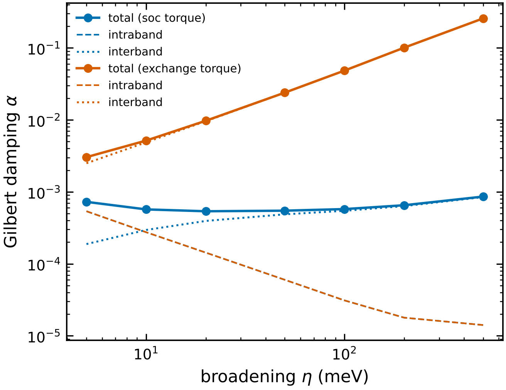

# 8 · Gilbert damping from first principles

```bash
magex damping bccFe_damping.toml          # mpirun -n 40 magex damping ... for dense k-meshes
```

magex computes the Gilbert damping tensor from the same Wannier Hamiltonian that gives the exchange,
using the torque–torque correlation (Kamberský) formula derived from the Kubo response of the band
energy to a slowly rotating magnetisation:

    α_μν = g/(π M) · (1/N_k) Σ_k Tr[ T_μ(k) A(k) T_ν(k) A(k) ],   A = η [(E_F − H)² + η²]⁻¹

M is the spin moment per cell (computed from the bands), η is the electron broadening (≈ ħ/2τ),
and T_μ = ∂H/∂θ_μ is the torque operator for a rotation about an axis perpendicular to the
magnetisation.  Two forms are available:

| `forms` | torque operator | use |
|---------|-----------------|-----|
| `"soc"` (default) | (i/2)[σ_μ, H_so] | physical damping; vanishes exactly without SOC |
| `"exchange"` | (e_μ × X)·σ, rotating the exchange field | identical as η → 0; carries a spurious interband term ∝ η (large in metals with a big exchange splitting) |

The output separates **intraband** (n = m, "breathing Fermi surface", ∝ 1/η, dominates in clean
metals at low temperature) and **interband** (n ≠ m, ∝ η, dominates at high temperature) parts,
which gives the characteristic minimum of α(η).

```toml
[damping]
soc = "atomic"                 # collinear input: add ξ L·S;  spinor input: "input"
kmesh = [110, 110, 110]
eta_meV = [5, 10, 20, 50, 100, 200, 500]
forms = ["soc", "exchange"]
directions = [[0, 0, 1], [1, 1, 0]]   # damping anisotropy
kT_meV = 0.0
```

Output: `damping_n001.json` (tensor vs η, intra/inter parts, moment, DOS) and `damping_n001.png/.pdf`.



bcc Fe (s, p, d Wannier functions, ξ_d = 55 meV, 110³ k-points, 7 min on 2 cores): α ≈ 5.4 × 10⁻⁴
at the minimum (η ≈ 20–50 meV), rising to 8.6 × 10⁻⁴ at η = 0.5 eV. These values are converged in k
for η ≥ 20 meV.  Published first-principles values for Fe are of order 10⁻³ and measured values ≈ 2 × 10⁻³; the
factor ~2 can come from the on-site atomic SOC model used here (non-local SOC and SOC on the s, p
states are absent), from the broadening model, and from conventions (some papers quote α against
ħ/τ = 2η).  Use a spinor Wannier Hamiltonian (`soc = "input"`) for the most complete SOC.  The prefactor derivation is
in the docstring of `magex/damping.py`.

## Using the result in simulations

```toml
[llg]                                   # atomistic
alpha = {from = "damping/damping_n001.json", eta_meV = 50}

[[region]]                              # micromagnetics
material = "Fe"
alpha = {from = "damping/damping_n001.json", eta_meV = 50, form = "soc"}
```

The value is interpolated in log–log at the chosen η.  With this, every LLG parameter (J, DMI, K, μ, α)
comes from one DFT calculation.

## Convergence

* the intraband term needs the Lorentzian to be resolved: k-spacing ≪ η / v_F; use ≥ 100³ points for
  η ≈ 10 meV in transition metals, MPI over k-chunks (`chunk` points per batch);
* check α(η) with two meshes, as in the figure (50³, 80³, 110³ agree to 2 % for η ≥ 20 meV);
* `kT_meV` adds Fermi–Dirac smearing on top of η.
