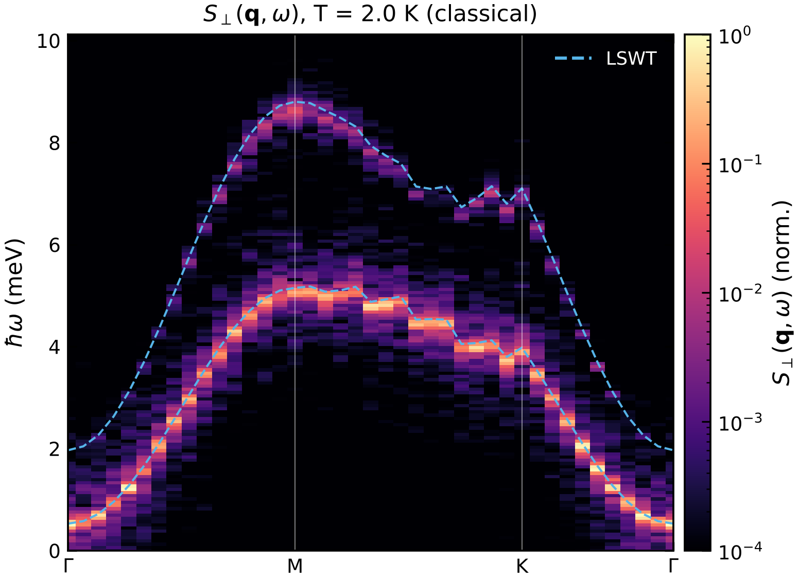
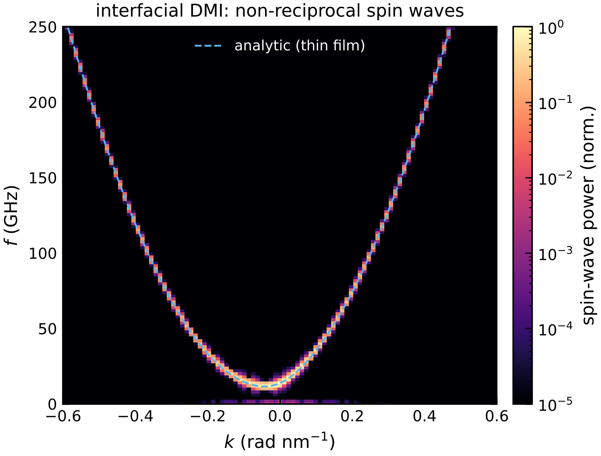

# 10 · Magnon spectra from spin dynamics

Linear spin-wave theory (`magex magnon`) gives the T = 0 harmonic magnons.  Spin dynamics gives the
full spectrum at any temperature (softening, broadening, lifetimes), and micromagnetics gives the
long-wavelength spin waves of finite films and devices, including dipolar and DMI effects.

## Atomistic: dynamical structure factor — `magex sqw`

```bash
cd examples/spindyn
magex sqw cri3_sqw.toml
```

```toml
[spinmodel]
results = "../../validation_runs/CrI3_atomic_soc/results.json.gz"
supercell = [30, 30, 1]
pbc = [true, true, false]

[sqw]
temperature = 2.0          # K
alpha = 0.005              # small damping -> sharp lines (or alpha = {from = "damping_n001.json", ...})
dt = 2e-3                  # ps
therm_steps = 5000
steps = 65536              # production steps
segments = 2               # Welch averaging (more segments: less noise, coarser energy resolution)
sample_every = "auto"      # Nyquist set from the LSWT band maximum
path = "GMKG"
special_points = {G = [0, 0, 0], M = [0.5, 0, 0], K = [0.333333, 0.333333, 0]}
thermostat = "classical"   # or "quantum" (Planck statistics of the magnons)
```

S⊥(q, ω) = ⟨|m⊥(q, ω)|²⟩ is computed with m(q, t) = N^-½ Σ_i e_i(t) e^{−iq·r_i} on q-points
commensurate with the supercell, Hann-windowed and averaged over time segments.  LSWT bands are
overlaid (`lswt = true`); the run prints the median deviation of the intensity maximum from the
lowest LSWT branch.



CrI3 monolayer at 2 K: both magnon branches of the honeycomb lattice and the anisotropy gap at Γ;
the intensity maxima agree with LSWT to 0.8 % of the bandwidth.  At higher temperature the lines
soften and broaden — information LSWT does not contain.  Output: `sqw.npz` (E, S⊥, S∥, q, LSWT)
and `sqw.png/.pdf`.

## Micromagnetic: spin-wave dispersion of films

```toml
[[stage]]
type = "dispersion"
axis = "x"                # propagation direction
time_ns = 0.5
fmax_GHz = 250            # sinc pulse bandwidth (sampling at 2.5 fmax)
B_amp_T = 0.001           # small amplitude: linear regime
kmax = 0.6                # plot range (rad/nm)
```

A sinc field pulse on one line of cells excites all wavevectors; m(x, t) along a line is recorded
with a fixed-step integrator (time step chosen automatically from the largest field) and 2D-Fourier
transformed.  The analytic thin-film dispersion (exchange, anisotropy, Zeeman, shape anisotropy and
the interfacial-DMI shift) is overlaid.



`examples/micromag/dmi_spinwaves.toml`: in-plane magnetised film (m ∥ y, k ∥ x) with
D = 1.5 mJ/m².  The DMI shifts the dispersion by (γ/2π)(2D/M_s) sin(kd)/d, so f(+k) ≠ f(−k) — the
signature measured by Brillouin light scattering to extract D.  Tests check the peak positions against
the analytic curves for PMA and DMI films (`tests/test_micromag.py`).
