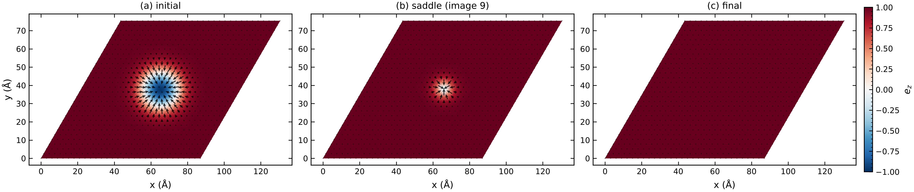
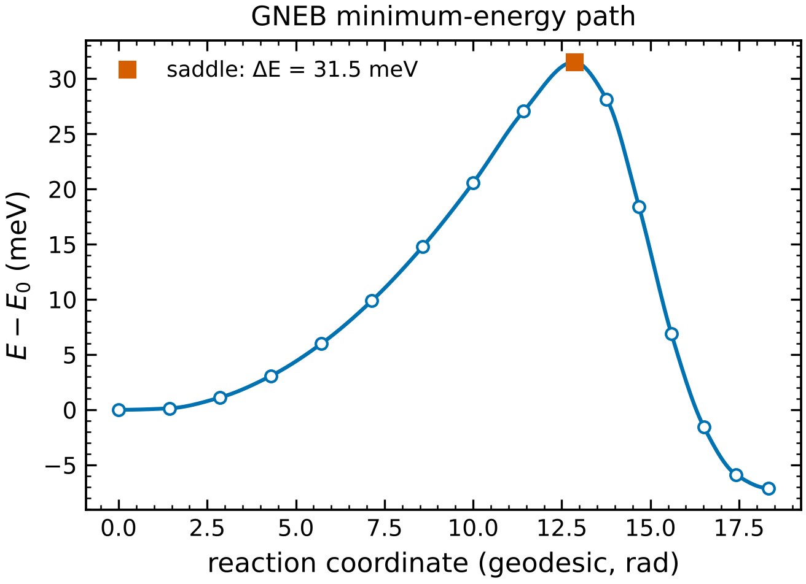
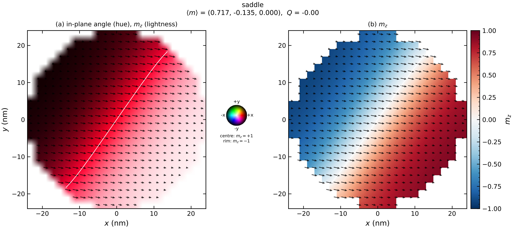
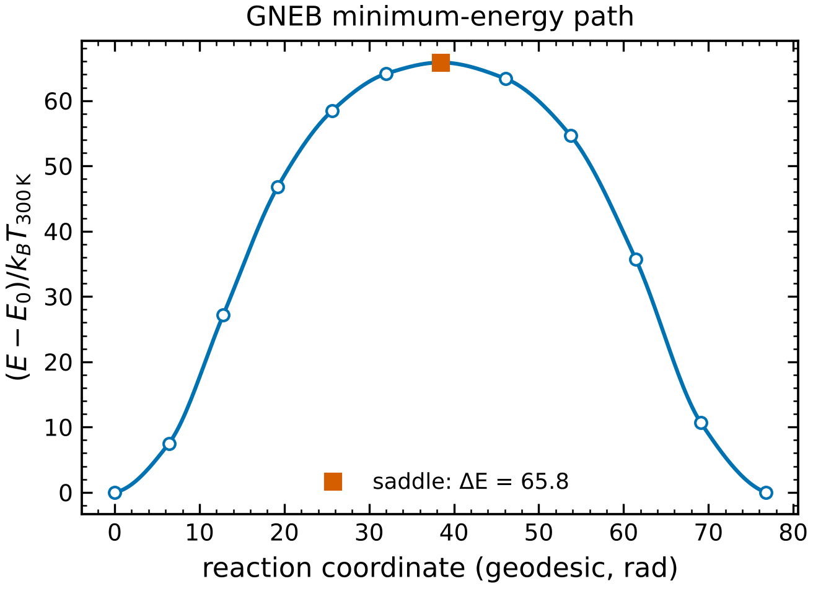

# 11 · Energy barriers and lifetimes (GNEB)

```bash
magex gneb examples/spindyn/skyrmion_gneb.toml     # atomistic skyrmion collapse
magex gneb examples/micromag/mram_barrier.toml     # thermal stability of an MRAM free layer
```

The geodesic nudged elastic band (Bessarab, Uzdin & Jónsson, CPC 196, 335 (2015)) finds the
minimum-energy path between two metastable states and its saddle point, i.e. the energy barrier ΔE
that sets the thermal lifetime τ = τ₀ exp(ΔE/k_BT) of skyrmions, domain states and bits.

* images are chains of unit vectors; distances are geodesic (√Σ arccos²(e·e′));
* upwind tangents projected on every spin's tangent plane; springs keep the images evenly spaced;
* the highest image climbs to the exact saddle (`climbing = true`);
* velocity-projection optimiser with a trust region (≤ 0.02 rad per spin per step);
* the spring constant is measured in units of the typical gradient along the initial path, so the
  same `spring = 1` works for meV (atomistic) and J (micromagnetic) energies;
* the end points are relaxed first; if both fall into the same minimum the run stops with a
  message (the texture is not metastable for those parameters).

```toml
[gneb]
engine = "atomistic"                          # or "micromag" (uses [mesh], [[region]], ...)
field = [0, 0, 6.0]
initial = {type = "skyrmion", radius = 10.0}  # A (atomistic) / any micromagnetic [init] spec
final = {type = "uniform", direction = [0, 0, 1]}
images = 16
spring = 1.0
climbing = true
rel_tol = 1e-4                                # stop when max force < rel_tol x initial
perturb = 0.02                                # random kick of the initial images (breaks symmetry)
temperature = 20.0
attempt_time = 1e-11                          # s
```

Outputs: `gneb.json` (path energies, barriers both ways, saddle image, lifetime), `gneb_path.png/.pdf`,
the initial/saddle/final states, `gneb_images.npz`.

## Atomistic skyrmion collapse




Triangular lattice, J = 2 meV, D = 1 meV, K = 0.2 meV, 6 T: the skyrmion shrinks and its core flips
at the saddle (ΔE = 31.5 meV, 1300 iterations, 7 s); the reverse barrier (FM → skyrmion) is 38.6 meV.
The skyrmion helicity is chosen automatically from the DMI.

## MRAM thermal stability




48 nm CoFeB/MgO disk, 1.2 nm: reversal proceeds by a domain wall sweeping across the disk, not by
coherent rotation, and ΔE = 66 k_BT at 300 K.  This agrees with the wall-energy estimate
σ_w d t = 4√(A K_eff) · 48 nm · 1.2 nm ≈ 72 k_BT and is far below the coherent (Stoner–Wohlfarth)
value K_eff V ≈ 360 k_BT — the reason MRAM free layers larger than ~30 nm lose stability
relative to the macrospin estimate.  The macrospin limit itself is a unit test
(ΔE = KV(1 − h)² to 10⁻³).

Lifetimes use a user-given attempt time τ₀ (typically 10⁻¹²–10⁻⁹ s); harmonic transition-state
prefactors (Hessian eigenvalues at the minimum and saddle) are not computed.
