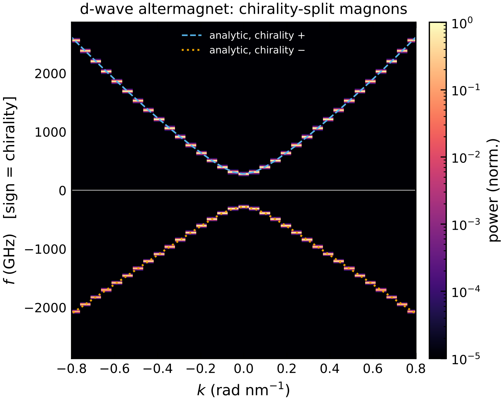
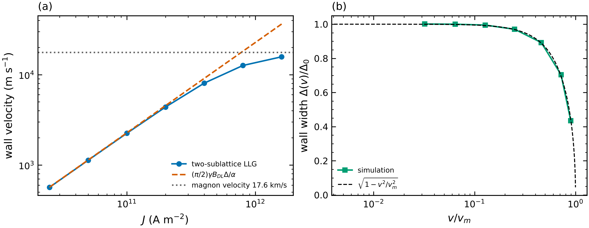

# 12 · Antiferromagnets, ferrimagnets and altermagnets (two-sublattice micromagnetics)

Adding an `[afm]` table to any micromagnetic input switches to the two-sublattice solver
(`magex.micromag.afm.TwoSublatticeMagnet`): two unit-vector fields m_A, m_B with their own M_s, A,
K, D and α, coupled by

| term | energy density | key |
|------|----------------|-----|
| homogeneous inter-sublattice exchange | J_AF m_A·m_B (J_AF > 0: antiparallel) | `J_AF` (J/m³) |
| inhomogeneous inter-sublattice exchange | A_AB Σ_i ∂_i m_A·∂_i m_B | `A_AB` (J/m) |
| demagnetisation | of the total M = M_A m_A + M_B m_B | `[demag]` |
| altermagnetic stiffness | A^A_i = A(1+δ, 1−δ, 1), A^B_i = A(1−δ, 1+δ, 1) | `altermagnet_delta` |

The solvers (relax, minimise, RK45, Heun, dispersion), SOT and fields work unchanged.  A ferrimagnet
uses different sublattice parameters per region: `sub_A = {Ms = 6e5}`, `sub_B = {Ms = 4e5}`.

Validation (`tests/test_micromag.py`): the antiferromagnetic resonance
f = (γ/2π)√(B_K(2B_E + B_K)) is reproduced to 0.04 % (280.3 GHz), and the altermagnet branches
agree with the analytic formula below.

## Altermagnet: chiral magnon splitting — `altermagnet_magnons.toml`

```toml
[afm]
J_AF = 4.0e7
altermagnet_delta = 0.3

[[stage]]
type = "dispersion"        # chirality resolved: f > 0 / f < 0 = the two circular polarisations
axis = "x"
time_ns = 0.1
fmax_GHz = 3000
```



In a collinear antiferromagnet the two magnon chiralities are degenerate.  The d-wave altermagnet
(sublattices related by a 90° rotation, so their stiffness tensors are swapped) splits them without
spin–orbit coupling:

    f_± = (γ/2π) [ √(((H_A + H_B)/2)² − B_E²) ± (H_A − H_B)/2 ],   H_s = B_K + B_E + (2A^s_x/M_s) k²

with a splitting (γ/2π)(4Aδ/M_s)k² along x and the opposite sign along y — the magnon counterpart of
the altermagnetic spin splitting of electron bands, relevant for spin-current generation by magnons.

## SOT-driven antiferromagnetic domain walls — `afm_dw_velocity.py`

```bash
cd examples/micromag && python afm_dw_velocity.py
```



A damping-like spin–orbit torque with σ perpendicular to the wall plane moves a Néel wall at
v = (π/2)γB_DLΔ/α (Gomonay et al., PRL 117, 017202 (2016)), reproduced exactly at low current.  Near
the magnon velocity v_m = 2γ√(A J_AF)/M_s the wall Lorentz-contracts, Δ(v) = Δ₀√(1 − v²/v_m²), and
v saturates — there is no Walker breakdown, unlike in ferromagnets.

## Using it from Python

```python
import numpy as np
from magex.micromag import Mesh
from magex.micromag.afm import TwoSublatticeMagnet
from magex.micromag.solver import RK45, relax

mesh = Mesh((256, 1, 1), (1e-9,) * 3)
afm = TwoSublatticeMagnet(mesh, demag=False)
afm.add_region(np.ones(mesh.n, bool), Ms=4e5, A=1e-11, Ku1=1e5, alpha=0.01, J_AF=4e7,
               sub_B={"Ms": 3e5})                     # ferrimagnet
m = afm.init("domain_wall", width_nm=10)             # m_B = -m_A
m = relax(afm, m)
afm.sot = dict(J=1e11, theta=0.1, sigma=[0, 1, 0], thickness=1e-9)
m, table = RK45(afm).run(m, 50e-12)
print(afm.neel(m))
```
