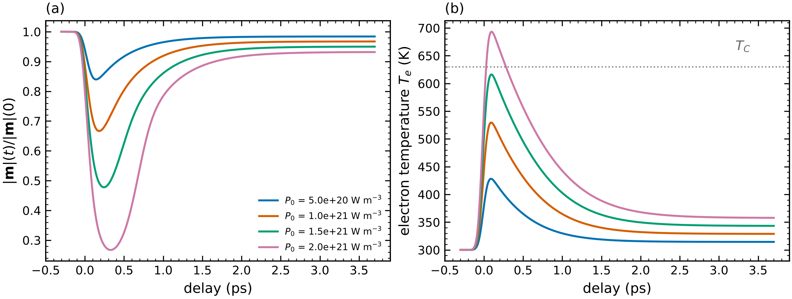

# 15 · Finite temperature in micromagnetics: Callen–Callen scaling and LLB

## Temperature-scaled parameters

```toml
[[region]]
material = "CoFeB"
temperature_K = 300
Tc = 1000                      # mean-field m_e(T) (classical Langevin) ...
# mc_results = "../spindyn/fe_mc/mc_results.csv"   # ... or the magex Monte Carlo m(T) curve
A_exponent = 1.8               # A(T) = A0 m_e^1.8   (and D)
K_exponent = 3.0               # K(T) = K0 m_e^3     (uniaxial single-ion, Callen-Callen)
```

Ms(T) = Ms0 m_e(T); the scaled values are printed.  With `mc_results` the whole chain is first
principles: exchange → Monte Carlo m(T) → micromagnetic parameters at the operating temperature.

## Landau–Lifshitz–Bloch and ultrafast demagnetisation

`magex.micromag.llb.LLB` integrates the LLB equation for the reduced magnetisation (|m| is not
conserved), with longitudinal and transverse damping α∥ = 2λT/3T_C, α⊥ = λ(1 − T/3T_C), the
longitudinal field from the mean-field χ∥(T), and the micromagnetic fields with A(T), K(T) scaled
consistently.  `TwoTemperature` adds the electron/lattice two-temperature model for laser
excitation.

```bash
cd examples/micromag && python ultrafast_demag.py
```



Ni (T_C = 630 K, λ = 0.05, γ_e = 1065 J m⁻³ K⁻², G = 8 × 10¹⁷ W m⁻³ K⁻¹, 50 fs pump): the
magnetisation drops within ~0.3 ps and recovers on the picosecond scale.  The larger the fluence,
the deeper and longer the quench as T_e approaches T_C (critical slowing down of the longitudinal
relaxation, τ∥ ∝ χ∥/α∥).

Checked in the tests: m_e(T) solves the Langevin self-consistency; a macrospin relaxes to
|m| = m_e(T) at every temperature; K scales as m_e³.

Limitations: the LLB is deterministic (no stochastic fields), so a fully quenched state (|m| = 0
with T_e > T_C for long times) cannot nucleate back without noise; mean-field χ∥ and m_e can be
replaced by any `me_func(T)` (e.g. `MCScaling` from Monte Carlo).
